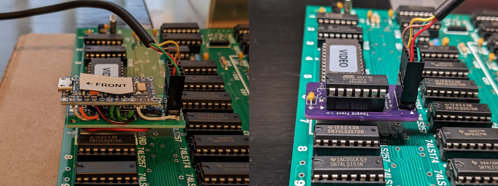
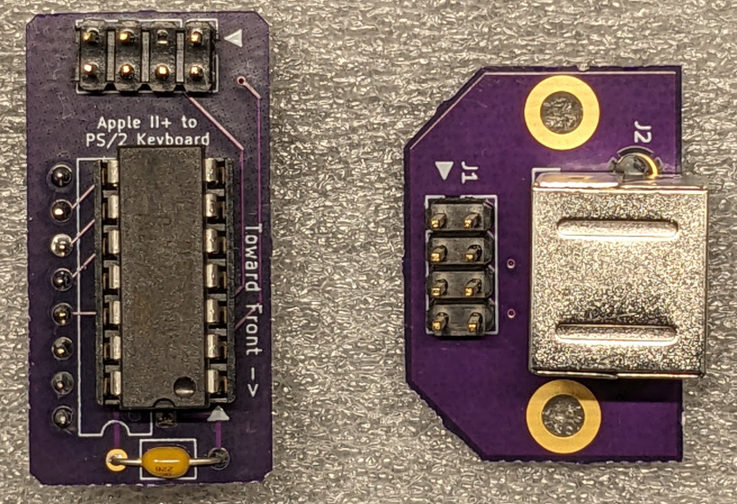
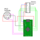
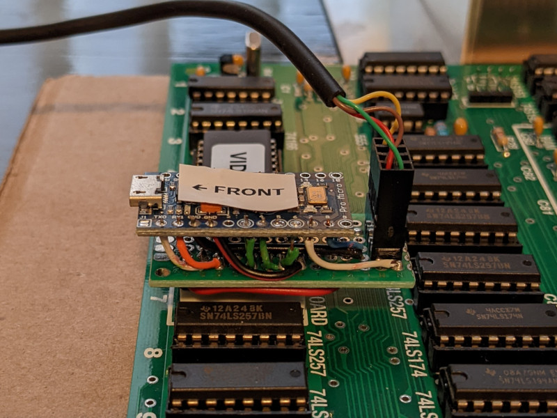

# Apple II Keyboard Adapter

This is a simple Arduino project to allow connecting a PS/2 keyboard to the
16 pin DIP keyboard connector on an Apple II. I've tested it on a
ReactiveMicro reproduction Apple II+ RFI logic board and it works great.

All keys are mapped to modern keyboard equivalents and the Apple can be
reset with the Ctrl-PrtScrn key combo.

I've built this project two different ways - the original prototype with a cheap Arduino Pro
Micro clone, and a newer version that consolidates all the wiring onto a small PCB with an
ATtiny24a microcontroller. This is very much a DIY project.

## ATtiny24a version

This version of the keyboard adapter is pretty simple and also includes a footprint for optional
ESD protection diodes to protect your Apple II from static discharges through the PS/2 interface.
It will require an ATtiny ISP (In-system Programmer) like the XGecu T48 or similar, or an Arduino
running the ArduinoISP sketch could also work.

It's composed of two parts: an adapter board with a microcontroller for performing the
translation logic and a connector board with the PS/2 keyboard connector that can be mounted
separately. If you want to use a different type of PS/2 connector then you are free to wire
up anything you need to the 8 pin header on the adapter board! For example, I can use an old
PC screw-mounted PS/2 connector.

### Building

This repo contains all the source files for building a Keyboard Adapter:
 * [KiCad project for the adapter board](./AppleII-Keyboard)
 * [KiCad project for a mountable PS/2 connector board](./AppleII-Keyboard-Connector)
 * [Source code for the microcontroller](./src/AppleII_PS2_Keyboard)

All the output files are also included so you don't need to install KiCad or the Arduino IDE if
you don't want to.
 * Schematics for the [adapter board](./AppleII-Keyboard/AppleII-Keyboard.pdf) and [connector board](./AppleII-Keyboard-Connector/AppleII-Keyboard-Connector.pdf)
 * Gerber files for the [adapter board](./AppleII-Keyboard/outputs/) and [connector board](./AppleII-Keyboard-Connector/outputs/)
 * [Pre-compiled ATtiny code](./src/AppleII_PS2_Keyboard/build/diy_attiny.avr.attiny24_diy/AppleII_PS2_Keyboard.ino.hex) to flash into the ATtiny

#### Parts List

Most of the parts are commodity and can be substituted for others, except for the ATtiny and the
ESD protection diodes. The ESD diodes are OPTIONAL so can be omitted if you can't find them or have
difficulty soldering the small surface-mount part.

You'll need one of each PCB; one PCB for the adapter that plugs into the keyboard connector on the
Apple II logic board and one PCB for the PS/2 mini-DIN connector board.

| Qty | Value                     | Mfr                 | MfrPartNo          | MouserPartNo         |
|-----|---------------------------|---------------------|--------------------|----------------------|
|  1  | 1x16 Machine Pin Header   | Samtec              | TS-116-T-A         | 200-TS116TA          |
|  1  | DIP-14 Socket             | TE Connectivity     | 1-2199298-3        | 571-1-2199298-3      |
|  1  | ATtiny24a                 | Microchip           | ATTINY24A-PU       | 556-ATTINY24A-PU     |
|  1  | 0.1uF                     | Vishay              | A104K15X7RF5TAA    | 594-A104K15X7RF5TAA  |
|  1  | Breakaway 2x8 pin headers | Amphenol            | 10129381-916001BLF | 649-1012938191601BLF |
|  1  | ESD Protection Diodes     | Diodes Incorporated | DT2042-04TS-7      | 621-DT2042-04TS-7    |
|  1  | Mini-DIN-6 connector      | Kycon               | KMDGX-6S-BS        | 806-KMDGX-6S-BS      |
|  2  | 2x4P IDC cable housing    | Amphenol            | 71600-008LF        | 649-71600-008LF      |

In addition to these components you will also need some 8 conductor 1.27mm pitch ribbon cable for
the cable between the adapter board and the connector board, as long as you need to reach wherever
you'll be mounting the PS/2 connector. This type of ribbon cable can be scavenged from common internal
cables that were used in old PCs.

#### Assembling

First, use a sharp thin knife on a solid surface (with protection) to split the 1x16 and 2x8 pin headers
in half so you end up with 2 1x8 machine pin headers and 2 2x4 square pin heders.

Then you can solder one of the 2x4 headers and the mini-DIN-6 connector to the connector board.

Soldering together the adapter board is a little more involved:
 1. If you have the ESD protection diode then carefully solder them on first. Pin 1 on the tiny package
    is marked with a dot that you may need a strong light and magnifying glass to see. This pin is marked
    on the PCB with a small triangle. After soldering on, check for shorts between any of the solder joints
    before continuing.
 2. The two 8-machine-pin headers should be installed next on the **underside** of the board as the
    silkscreen is facing you. The board's silkscreen has an IC outline that the two pin headers will be
    installed around. Since the headers are on the underside of the board you will be soldering on the top
    of the board around that IC outline.

    It helps to keep the pin headers straight if you insert them into a solderless breadboard or protoboard
    and then rest the PCB on top while soldering them in place.
 3. Install the DIP-14 IC socket on the top side of the board oriented so that pin 1 is pointed to by the
    triangle on the silkscreen. The IC sockets referenced in the part list will easily clear the solder
    joints of the pin headers from step 2 but if yours don't then you'll have to file a channel so they do.

    Half of the socket's pins will be between the two pin headers from step 2 so getting the soldering iron
    to them is a little tight.
 4. Install the decoupling capacitor on the top side of the board and solder in place.

To assemble the 8 pin ribbon cable just make sure that the same wire is entering the marked pin 1 position
on both connector housings. The ribbon cable can enter either side of the housing as long as that wire lines
up with the pin 1 position.

#### Flashing the ATtiny

These steps will vary depending on the programmer and software you use. I can confirm that the XGecu T48
programmer works but I am sure there are many others. An Arduino running the ArduinoISP sketch should also
work (though setting fuse values looks much more complicated).

1. Select the ATtiny24a device (DIP14 packaging if the different packages are listed) in your programming software.
2. Load [the .hex file](./src/AppleII_PS2_Keyboard/build/diy_attiny.avr.attiny24_diy/AppleII_PS2_Keyboard.ino.hex)
   into your programming software. Make sure to load it as a hex file and not as a binary file.
3. Find and open the tab or dialog box to set the ATtiny fuse values. In the Xgpro application these settings are
   on the "Config" tab.
   * clear CKDIV8=0  (to disable clock division by 8)
4. Program the ATtiny

## Arduino Pro Micro version

#### Parts list
 1. Arduino. I used a cheap Arduino Pro Micro clone from Amazon but
    you could probably adapt to use whatever you have on hand.
 2. Female PS/2 connector
 3. 2 8-pin male machine pin headers, or some other connector for the
    DIP-16 socket on the Apple II logic board.

#### Assembling

_Warning_: The DIP-16 connector on the logic board does have some pins with
higher voltages that will destroy your Arduino if you accidentally connect to
them, so take care.

The Arduino hole pattern is too wide for the DIP-16 socket so I used another
PCB to hold the machine pins and then jumpered the Arduino to the pins on top.
I also used a pin header to connect to a spare PS/2 connector from an old PC.

It's not so pretty, but it's compact and cost almost nothing.

